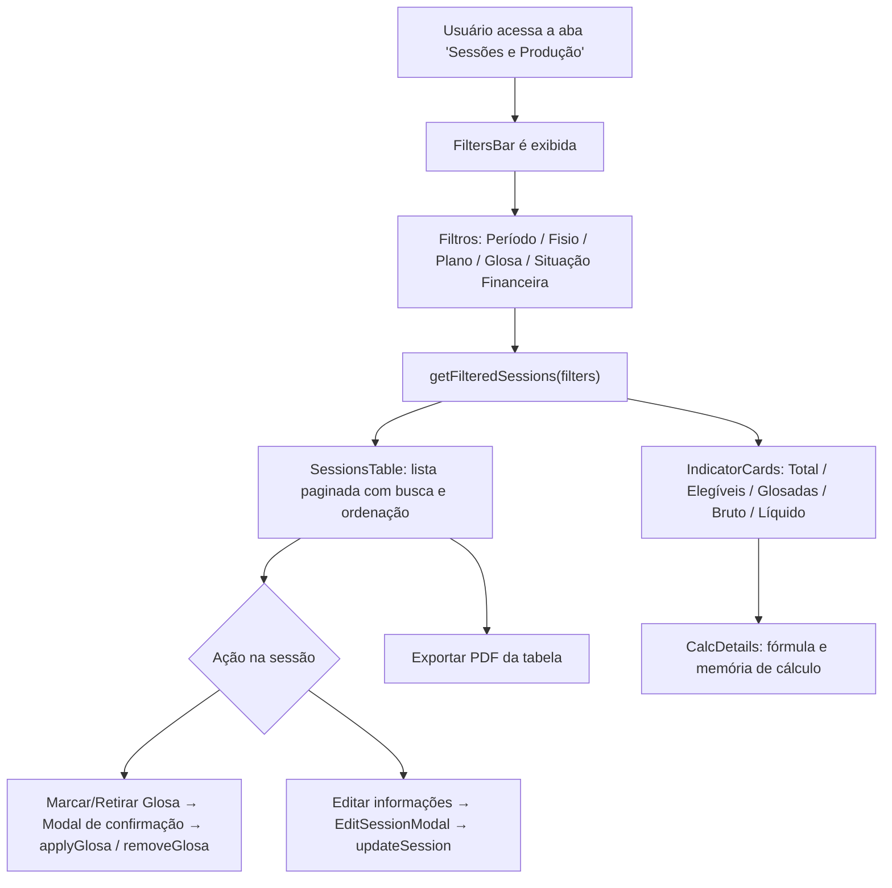
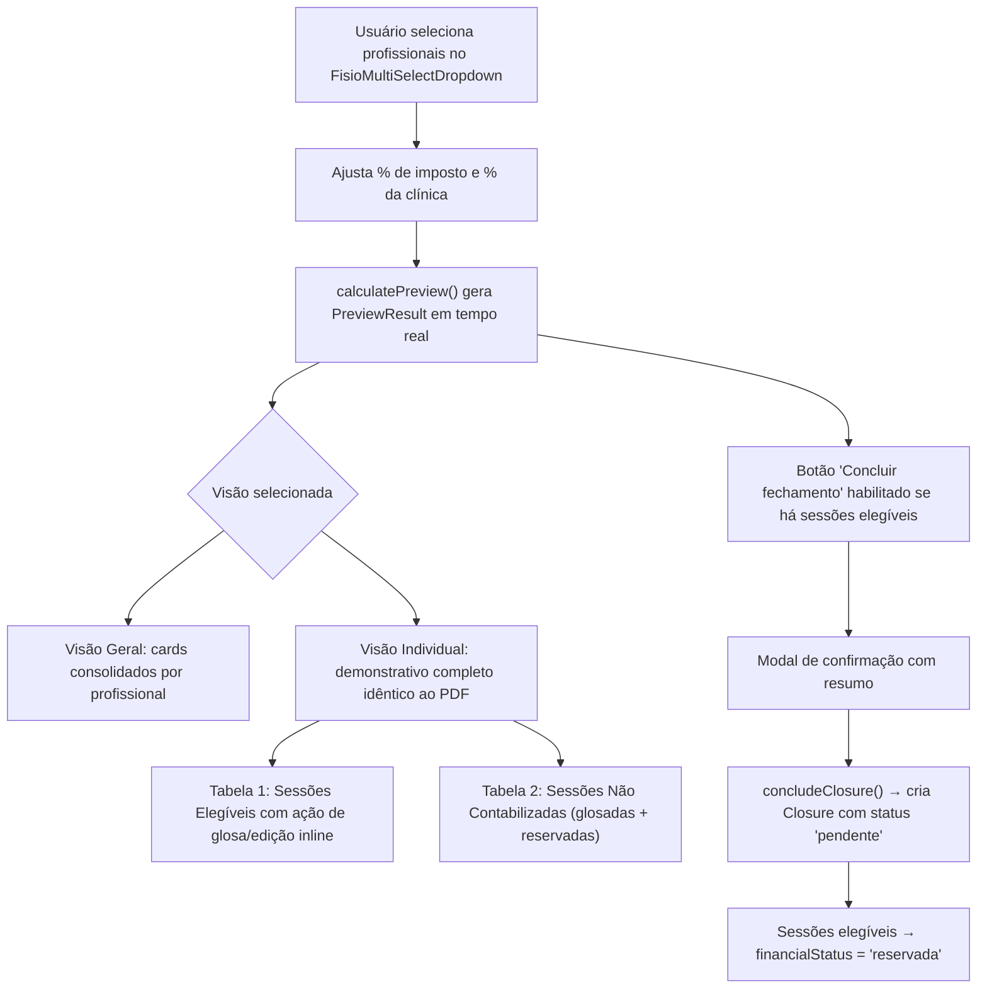
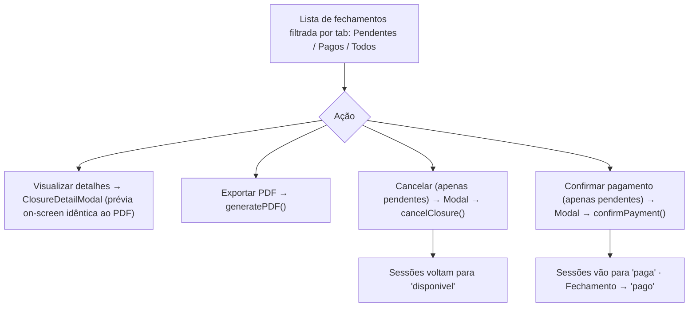
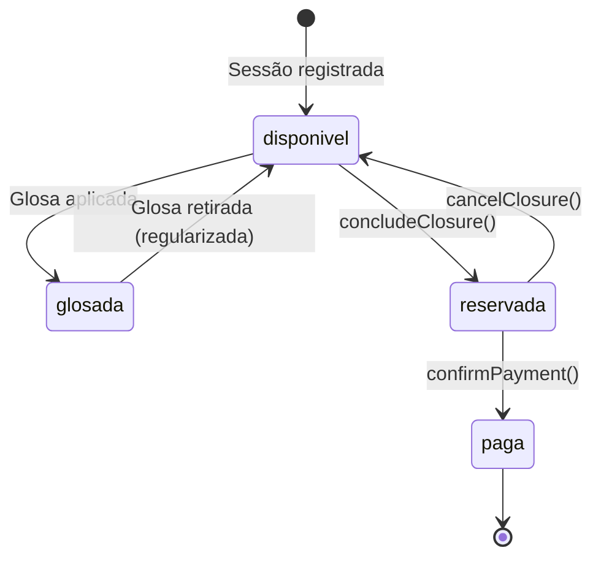

# Harmonia Fisioterapia — Descrição Completa do Fluxo do Sistema

> [!NOTE]
> Este documento descreve o fluxo completo do projeto **Harmonia**, um sistema de gestão de produção e pagamento de fisioterapeutas, construído em **React + TypeScript** com persistência via `localStorage`.

---

## 🏗️ Visão Geral da Arquitetura

```
src/
├── types.ts        → Tipos e interfaces de domínio
├── data.ts         → Dados iniciais (seed) e constantes globais
├── utils.ts        → Funções utilitárias, formatadores e regras de negócio
├── useStore.ts     → Gerenciamento de estado global (hook customizado)
├── pdfGen.ts       → Geração de relatórios PDF
└── App.tsx         → Interface do usuário (todos os componentes visuais)
```

---

## 📦 Modelos de Dados (`types.ts`)

### `Session` — Sessão de Atendimento
Representa uma sessão individual de fisioterapia realizada por um profissional para um paciente.

| Campo | Tipo | Descrição |
|---|---|---|
| `id` | string | Identificador único |
| `date` | string | Data da sessão (ISO `yyyy-mm-dd`) |
| `competenceDate` | string? | Data de competência (mês de referência) |
| `patient` | string | Nome do paciente |
| `guia` | string | Número da guia + plano |
| `plano` | string | Nome do plano de saúde |
| `fisioId` | string | ID do fisioterapeuta responsável |
| `registeredBy` | string | Usuário que registrou |
| `valuePerSession` | number | Valor pago por essa sessão |
| `glosa` | `'nao_glosada' \| 'glosada'` | Status de contestação |
| `financialStatus` | `'disponivel' \| 'reservada' \| 'paga'` | Status financeiro |
| `closureId` | string? | ID do fechamento ao qual está vinculada |

### `Closure` — Fechamento Financeiro
Agrupa sessões elegíveis de um período e registra os cálculos para pagamento aos profissionais.

| Campo | Descrição |
|---|---|
| `id` | Código no formato `FCH-YYYY-NNN` |
| `status` | `pendente`, `pago` ou `cancelado` |
| `fisioIds` | Lista de fisioterapeutas incluídos |
| `sessions` | Lista de sessões incluídas (`sessionId + value`) |
| `grossValue` | Valor bruto total |
| `taxPercent / taxValue` | Percentual e valor do imposto |
| `clinicPercent / clinicValue` | Percentual e valor da parcela da clínica |
| `netValue` | Valor líquido a ser repassado |
| `perFisio` | Breakdown por profissional |

### `FilterState` — Estado dos Filtros da UI
Controla o filtro de datas, fisioterapeuta, plano, glosa e situação financeira na tabela principal.

---

## 🌱 Dados Iniciais (`data.ts`)

- **3 fisioterapeutas** cadastrados: Carla Mendes (`f1`), Rafael Costa (`f2`) e Fernanda Rocha (`f3`), cada um com avatar colorido e CREFITO.
- **Constantes globais**: `TAX_PERCENT = 5%` e `CLINIC_PERCENT = 50%`.
- **Sessões de exemplo**: ~26 registros cobrindo de Jan/2025 a Ago/2026, com cenários variados: pagas, disponíveis, reservadas, glosadas e regularizadas.
- **Fechamentos de exemplo**:
  - `FCH-2026-001` — Status **pago**, 4 sessões, valor líquido \~R$ 250.
  - `FCH-2026-003` — Status **pendente**, 3 sessões, valor líquido \~R$ 186.

---

## 🧮 Regras de Negócio (`utils.ts`)

### Elegibilidade de uma Sessão
```ts
isEligible(session) → glosa === 'nao_glosada' AND financialStatus === 'disponivel'
```
Apenas sessões elegíveis entram no cálculo de fechamento.

### Cálculo do Valor Líquido
```
Bruto → − Imposto (taxPct%) → Saldo → − Parcela clínica (clinicPct% s/ saldo) → Líquido
```
Exemplo com padrões (5% + 50%): R$ 1.000 bruto → − R$ 50 imposto → R$ 950 → − R$ 475 clínica → **R$ 475 líquido**.

### Funções utilitárias
- `formatBRL(value)` — Formata moeda no padrão brasileiro (R$)
- `formatDate(iso)` — Converte `yyyy-mm-dd` → `dd/mm/yyyy`
- `formatDateTime(iso)` — Data e hora no padrão pt-BR
- `formatClosureCode(id)` — Normaliza IDs antigos para o formato `FCH-YYYY-NNN`
- `buildPreview(...)` — Calcula a prévia de fechamento por profissional
- `buildClosureFisioEntries(...)` — Monta o breakdown por fisioterapeuta para um fechamento

---

## 🗄️ Gerenciamento de Estado (`useStore.ts`)

O hook `useStore()` é o coração do sistema. Ele carrega e salva dados automaticamente no `localStorage` (chave `harmonia_sessions_v4` / `harmonia_closures_v4`).

### Ações disponíveis

| Ação | O que faz |
|---|---|
| `applyGlosa(id)` | Marca uma sessão como glosada (somente se `disponivel`) |
| `removeGlosa(id)` | Retira a glosa de uma sessão, registrando `regularizationDate` |
| `updateSession(id, changes)` | Edita campos de uma sessão |
| `getPreview(fisioIds, taxPct, clinicPct)` | Calcula a prévia de fechamento sem persistir |
| `concludeClosure(fisioIds, taxPct, clinicPct)` | **Cria um fechamento**: agrupa sessões elegíveis, cria o registro `Closure` com status `pendente`, e muda `financialStatus` das sessões para `reservada` |
| `cancelClosure(closureId)` | Cancela um fechamento pendente e devolve as sessões para `disponivel` |
| `confirmPayment(closureId)` | Marca o fechamento como `pago` e as sessões como `paga` (irreversível) |
| `getFilteredSessions(filters)` | Retorna sessões filtradas por período, fisio, plano, glosa e situação financeira |
| `getIndicators(filtered)` | Calcula indicadores resumo: total, elegíveis, glosadas, bruto e líquido |
| `resetDemo()` | Restaura o estado inicial (seed data) |

---

## 🖥️ Interface do Usuário (`App.tsx`)

### Layout Geral

```
┌─────────────────────────────────────────────────────────┐
│  Sidebar (colapsável)  │  Conteúdo Principal             │
│  - Início              │  Page Header + Tabs             │
│  - Pacientes           │  ┌──────────────────────────┐   │
│  - Tratamentos         │  │  Tab: Sessões e Produção  │   │
│  - Sessões             │  │  Tab: Prévias e Fechamento│   │
│  - Fisioterapeutas     │  └──────────────────────────┘   │
│  - Planos              │                                  │
│  - Relatórios ← ativo  │                                  │
│  - Financeiro          │                                  │
│  - Configurações       │                                  │
│  [GS] Gabriela Souza   │                                  │
└─────────────────────────────────────────────────────────┘
```

> [!IMPORTANT]
> O sistema atualmente renderiza apenas a tela de **Relatório de Produção e Pagamento**. Os demais itens da sidebar são visuais (decorativos), sem navegação implementada.

---

## 📋 Fluxo da Aba "Sessões e Produção"



### Componentes desta aba

| Componente | Função |
|---|---|
| `FiltersBar` | Barra de filtros configurável (o usuário pode ocultar/mostrar filtros individualmente via `FilterConfigButton`) |
| `IndicatorCards` | 5 cards resumo: total de sessões, elegíveis, glosadas, valor bruto e valor líquido previstos. Pode ser colapsado/expandido. |
| `SessionsTable` | Tabela paginável com busca por texto, ordenação por coluna (data, paciente, fisio, valor) e seletor de quantidade de linhas por página (10/25/50/100). |
| `ActionMenu` | Menu dropdown por sessão com ações de glosa e edição. Detecta espaço vertical para abrir para cima quando necessário. |
| `EditSessionModal` | Formulário modal de edição de sessão (paciente, guia, datas, valor, glosa). Campos de glosa bloqueados se a sessão não está disponível. |
| `CalcDetails` | Painel explicativo da fórmula de cálculo, com memória de cálculo em tempo real. |

---

## 💰 Fluxo da Aba "Prévias e Fechamento"

Esta aba tem duas sub-abas:

### Sub-aba: Apuração e Prévia



### Sub-aba: Fechamento



---

## 📄 Geração de PDF (`pdfGen.ts`)

A função `generatePDF()` gera relatórios em formato PDF diretamente no browser (sem servidor), com o seguinte conteúdo:

- **Cabeçalho**: Logo da clínica + título "Relatório de Produção e Fechamento"
- **Metadados**: Período, data de fechamento, parâmetros (imposto e clínica)
- **Por fisioterapeuta**: Resumo financeiro (sessões elegíveis, bruto, deduções, líquido) + tabela de sessões elegíveis + tabela de sessões não contabilizadas
- **Totais consolidados**: Valor bruto total e valor líquido total

Pode ser chamado:
1. Da tabela principal (exporta a visão filtrada atual)
2. Do painel de Apuração (prévia antes de concluir)
3. De um fechamento específico (relatório oficial)

---

## 🔄 Ciclo de Vida de uma Sessão



> [!CAUTION]
> Uma vez que uma sessão vai para o status **`paga`**, ela não pode mais ser alterada. O fechamento associado também fica permanentemente como `pago`.

---

## 💾 Persistência (localStorage)

| Chave | Conteúdo |
|---|---|
| `harmonia_sessions_v4` | Array de todas as sessões |
| `harmonia_closures_v4` | Array de todos os fechamentos |
| `harmonia_sidebar_collapsed` | Estado colapsado da sidebar |
| `harmonia_show_indicators` | Indicadores visíveis ou colapsados |
| `harmonia_visible_filters` | Quais filtros estão visíveis na FiltersBar |

> [!NOTE]
> O sistema inclui migração transparente de versões anteriores (`v3`), lendo de chaves antigas como fallback antes de retornar aos dados de seed.

---

## 🎨 Componentes Reutilizáveis

| Componente | Descrição |
|---|---|
| `Modal` | Overlay modal genérico com título, subtítulo, corpo e rodapé |
| `GlosaBadge` | Badge verde/vermelho para situação de glosa |
| `FinancialBadge` | Badge colorido para situação financeira + link ao fechamento |
| `ClosureBadge` | Badge de status do fechamento (Pendente/Pago/Cancelado) |
| `Icon` | Componente de ícone SVG inline via path string |
| `FisioMultiSelectDropdown` | Seletor múltiplo de profissionais com avatar, crefito e ações de selecionar/desmarcar todos |
| `FilterConfigButton` | Dropdown de configuração de filtros visíveis |
